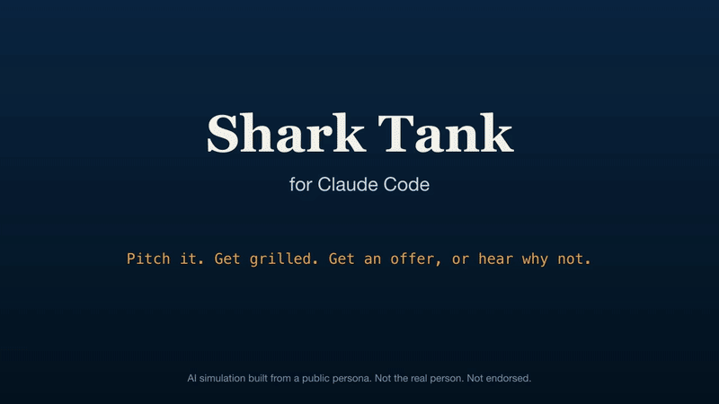
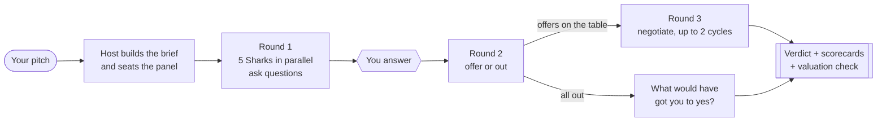

<p align="center">
  
</p>

<p align="center">
  <b>Pitch any business idea to a panel of five AI Sharks inside Claude Code.</b><br>
  They grill you, make offers or go out, negotiate, and a Host writes the verdict with scorecards and a valuation check.
</p>

<p align="center">
  <a href="LICENSE"></a>
  <a href="https://github.com/sidrat2612/shark-tank-skill/actions/workflows/validate.yml"></a>
  <a href="https://github.com/sidrat2612/shark-tank-skill/releases"></a>
  
  
  <a href="CONTRIBUTING.md"></a>
</p>

<p align="center"><i>The Sharks are simulations built from public persona. They are not the real people and are not affiliated with or endorsed by them, the show, or its producers.</i></p>

<p align="center">
  
</p>

---

## Why

Friends say your idea is great. Investors say no and rarely tell you why. This puts your pitch in front of the people famous for saying why, out loud, in under a minute: the valuation is crazy, the margin dies at wholesale, the patent covers a latch, your co-founder is part-time.

You get the same five-minute ordeal as the show, then a written report on exactly what to fix before you pitch anyone with a real checkbook.

## Install

**As a plugin** (recommended). In Claude Code:

```text
/plugin marketplace add sidrat2612/shark-tank-skill
/plugin install shark-tank@shark-tank-skill
```

Then run it as `/shark-tank:shark-tank`.

**By copying files.** Installs `/shark-tank` and `/newshark` for every project:

```bash
curl -fsSL https://raw.githubusercontent.com/sidrat2612/shark-tank-skill/main/install.sh | bash
```

Add `-s -- --project` to install into the current project's `.claude/` instead. Restart Claude Code after installing.

## Quickstart

```text
/shark-tank Smart lunchbox for school kids: insulated box with an app-connected
temperature and "did they eat" sensor. Sold 2,400 units in 11 months at $69
retail, $31 cost. Two co-founders, one full-time. Provisional patent on the
sensor latch. Asking $250,000 for 10%.
```

What happens next:

1. **The brief.** The Host restates your pitch, computes the implied valuation, and asks for anything missing (traction, unit economics) in one batch.
2. **The panel.** It seats five Sharks picked for your pitch, always including a money seat and a likely dissenter.
3. **The grilling.** All five read your brief in parallel. Their questions come back deduped and ordered hardest first. You answer in chat. "I don't know" is allowed, and they notice.
4. **Offers or out.** Each Shark makes an offer (amount, equity, structure, conditions, implied valuation) or says I'm out, with one reason.
5. **Negotiation.** Accept, counter, ask two Sharks to team up, or walk. Up to two counter cycles.
6. **The verdict.** A short verdict in chat and a full `verdict.md` in `sessions/`.

<details>
<summary><b>See the verdict from that exact pitch</b> (unattended run, every Shark went out)</summary>

> **No deal.** All five Sharks went out. Panel score 2.5/10.
>
> Ask: 250,000 for 10%, a 2,500,000 valuation, about 15 to 18 times revenue. No offers.
>
> - **Mr. Wonderful** 2/10: single digits a box cannot pay anyone back.
> - **Lori** 3/10: the shelf math breaks at 41 wholesale.
> - **Cuban** 2/10: a patent on a latch is not a moat against a 5 dollar sensor.
> - **Barbara** 3/10: half a team is half a bet.
> - **Daymond** 2/10: at a 36 landed cost, every new retailer loses money.
>
> **The question that hurt most:** what does one unit really cost to land?
>
> **Fix before real investors:**
> 1. Landed cost under 25 (ideally 18), proven with a factory quote at 10,000 units.
> 2. Measure the sensor's running cost and app use after September. Test a subscription.
> 3. Put the part-time co-founder on a full-time date and trademark the name.

Read the whole session, card by card: [`sessions/2026-11-08-example-smart-lunchbox/`](sessions/2026-11-08-example-smart-lunchbox/). Start with [`verdict.md`](sessions/2026-11-08-example-smart-lunchbox/verdict.md).

</details>

## The Sharks

Each Shark is one agent file plus a brain: eight files of background, frameworks, decision rules, stances, voice, deals, books, and a cited source list. Every brain was fact-checked against public sources, with URLs, and includes an honest section on where that Shark's lens misfires.

**US panel** (default)

| Shark | Seat | Goes out fast when |
|---|---|---|
| Mark Cuban | Tech, scale, and competitive moat | You cannot state your numbers from memory |
| Kevin O'Leary | Money, valuation, and return on capital | Crazy valuation, no path to repayment |
| Lori Greiner | Consumer product, retail, and TV/QVC sellability | It is not a product she can put on a shelf |
| Barbara Corcoran | The founder, sales grit, and gut read | Excuses, blaming the market, no hunger |
| Daymond John | Brand, licensing, and manufacturing | No brand story, manufacturing not figured out |
| Robert Herjavec | B2B, software, security, and sales process | No sales process, no pipeline numbers |

**India panel** (`--india`)

| Shark | Seat | Goes out fast when |
|---|---|---|
| Aman Gupta | D2C brand building and marketing in India | No brand differentiation |
| Namita Thapar | Healthcare, governance, and unit economics | Fuzzy numbers, regulatory risk ignored |
| Anupam Mittal | Internet marketplaces, consumer tech, network effects | Copycat idea, no retention data |
| Vineeta Singh | D2C execution and customer obsession | Low repeat purchase, no customer insight |
| Peyush Bansal | Product, customer problem, and operations | A solution looking for a problem |

Pitch in any currency. The Host echoes it and never converts.

## Commands

| Command | What it does |
|---|---|
| `/shark-tank <pitch>` | Full tank: five Sharks, three rounds, verdict |
| `/shark-tank <pitch> --quick` | Three Sharks, four questions, take-it-or-leave-it offers |
| `/shark-tank <pitch> --india` | The Shark Tank India panel |
| `/shark-tank <pitch> --sharks cuban,thapar,john` | Pick your own panel, mixing countries |
| `/shark-tank <pitch> --all` | Up to seven Sharks |
| `/shark-tank <pitch> --no-questions` | Sharks state assumptions instead of asking. Runs unattended |
| `/shark-tank ask oleary should I take a royalty deal?` | One Shark, one answer |
| `/shark-tank panel` | See the roster and change the default panel |
| `/newshark <Full Name>` | Add a new Shark seat |

In plugin installs, prefix the skills with `shark-tank:`, for example `/shark-tank:shark-tank`.

## How it works



- **The Host** (`skills/shark-tank/SKILL.md`) runs the room. It never pitches, never invests, and never rewrites a Shark's words.
- **The Sharks** (`agents/shark-*.md`) are sub-agents with read-only tools. Each reads its own brain before answering.
- **The math is checked.** Every offer must state its implied valuation (amount / equity). The Host verifies it, computes a weighted panel score, and compares the ask to the revenue multiple.
- **Everything is saved** to `sessions/<date>-<pitch>/`: the brief, every card from every round, and the verdict.

A full tank is 15 sub-agent runs (5 Sharks x 3 rounds). Use `--quick` for a cheaper read.

## Other coding agents (experimental)

The skill also installs for Codex, GitHub Copilot, Cursor, and Gemini CLI. All four read `.agents/skills/`. Each has its own sub-agent format, so `scripts/adapters.py` converts the Shark agent files.

```bash
git clone https://github.com/sidrat2612/shark-tank-skill.git
python3 shark-tank-skill/scripts/adapters.py install all --dest /path/to/your/project
```

Use `codex`, `copilot`, `cursor`, or `gemini` in place of `all` to install one. Then run `/shark-tank <pitch>` (Codex: `$shark-tank`). If the tool cannot run sub-agents in parallel, the Host plays the Sharks one at a time and says so in the verdict.

Only Claude Code is tested end to end. The others follow each tool's current docs but are not yet verified in a live run. Reports from real runs are welcome as issues.

After editing anything in `agents/`, run `python3 scripts/adapters.py build`. `validate.py` fails if `adapters/` is stale.

## Add your own Shark

```text
/newshark Steven Bartlett
```

It asks four questions (the lens, where they are known from, deal style, who they clash with), then writes the brain, the agent file, and the roster entry, and runs the checks. See [CONTRIBUTING.md](CONTRIBUTING.md) to send it upstream.

## FAQ

<details>
<summary><b>Are these really the Sharks?</b></summary>

No. Each is a simulation built from public persona: interviews, books, episode records, and reporting, all listed in that Shark's `sources.md`. Nothing is from, or endorsed by, the real people.
</details>

<details>
<summary><b>Why no real quotes?</b></summary>

Because we cannot check them against a transcript, and a made-up quote attributed to a real person is worse than none. The brains paraphrase everything, and CI rejects any brain file that contains quotation marks. Each Shark's voice is described, and its sample lines are labeled as written in their style, not their words.
</details>

<details>
<summary><b>Is this investment advice?</b></summary>

No. It is a tough rehearsal. The value is in the questions you could not answer, not in the score.
</details>

<details>
<summary><b>How much does a run cost?</b></summary>

A full tank is 15 sub-agent calls, each reading a few short Markdown files. `--quick` is about a third smaller. A single-Shark consult is one call.
</details>

<details>
<summary><b>Can I add Dragons' Den or Shark Tank Australia investors?</b></summary>

Yes. Use `/newshark`, and open a PR. Seat requests are welcome as issues too.
</details>

## Contributing

New Sharks, sharper brains with better sources, and Host improvements are all welcome. Read [CONTRIBUTING.md](CONTRIBUTING.md), then run:

```bash
python3 scripts/validate.py
```

CI runs the same check on every PR, plus `claude plugin validate`.

## Credits

The one-agent-plus-brain-per-seat design is adapted from [nateherkai/roast-room](https://github.com/nateherkai/roast-room). Shark Tank is a trademark of its owners; this project is an unaffiliated fan tool.

## Enjoyed your pitch?

If the Sharks made you sharper, a star on this repo helps other founders find it. Share your verdict, and keep the line that the Sharks are simulations.

## Star history

<a href="https://star-history.com/#sidrat2612/shark-tank-skill&Date">
  
</a>

## License

[MIT](LICENSE). The Sharks are simulations of public figures for education and entertainment; see the disclaimer at the top.
